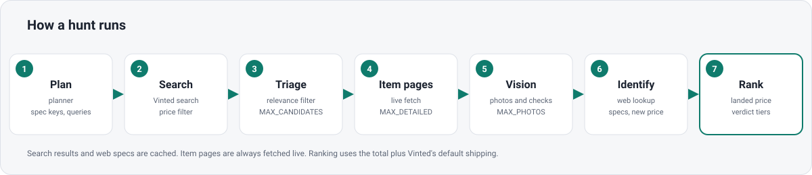

<div align="center">


# Vinted Hunter


[](https://github.com/jere344/vinted-hunter/actions/workflows/ci.yml)
[](LICENSE)
[](pyproject.toml)

</div>

Vinted Hunter is a local web app that searches vinted.fr for the items you describe and ranks the listings by what they really cost you. It plans the search, reads listings and photos with Claude, looks up each item's specs, and sorts the results.



## Quick start

You need Python 3.12 or newer.

```bash
python3.12 -m venv .venv && . .venv/bin/activate
pip install -e ".[dev]" && cp .env.example .env
vinted-hunter
```

Then open http://127.0.0.1:8000 in your browser.

## Choosing a backend

- `claude-cli` (default) runs the local `claude -p` command, so it uses your Claude subscription login. No API key is needed, but the Claude Code CLI must be installed and logged in.
- `api` calls the Anthropic API directly. Set `LLM_BACKEND=api` and `ANTHROPIC_API_KEY`. It is billed per token.

## Configuration

Settings are read from environment variables first, then from `.env` in the project root. Real environment variables win over `.env`.

| Variable | Default | What it does |
| --- | --- | --- |
| `LLM_BACKEND` | `claude-cli` | `claude-cli` or `api` |
| `ANTHROPIC_API_KEY` | none | Needed only when `LLM_BACKEND=api` |
| `PLANNER_MODEL` | `claude-haiku-5-5` | Model for planning the search |
| `TRIAGE_MODEL` | `claude-haiku-5-5` | Model for the first pass over listings |
| `EXTRACT_MODEL` | `claude-haiku-5-5` | Model for reading item pages |
| `SPECS_MODEL` | `claude-haiku-5-5` | Model for looking up item specs |
| `RANK_MODEL` | `claude-haiku-5-5` | Model for ranking |
| `MAX_DETAILED` | `60` | Max item pages to fetch per search |
| `MAX_PHOTOS` | `6` | Max photos per item sent to Claude |
| `SEARCH_PAGES` | `1` | Vinted result pages to read per search |
| `DATA_DIR` | `./data` | Where local data is stored |

For a better ranking you can set `RANK_MODEL=claude-opus-5-5`. It costs much more per token. Every other variable is listed in `.env.example`.

## How ranking works

Each listing is ranked by its landed price: the item price, plus the buyer fee, plus Vinted's default shipping when it is known. Each requirement you set is marked as verified, unverified, or failed, so you can see how sure the app is about each match.

## Disclaimer

Vinted Hunter reads vinted.fr pages. Vinted has no public API for this, so the app is unofficial. It is meant for personal use: low volume, shopping only, no bulk collection and no automated purchases. It waits a few seconds between requests (`VINTED_MIN_DELAY_S`, 2.5 by default). Vinted can change or block its pages at any time, and you are responsible for following their terms of service.

This project is not affiliated with, endorsed by, or sponsored by Vinted or Anthropic.

## Development

```bash
make install   # install with dev extras
make test      # pytest, no network and no real Claude calls
make lint      # ruff check
make run       # start the server
```

## Contributing and license

See [CONTRIBUTING.md](CONTRIBUTING.md) before opening a pull request. Vinted Hunter is released under the [MIT License](LICENSE).
