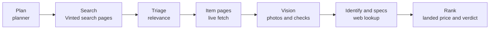

<div align="center">


# Vinted Hunter


**Best value on vinted.fr, checked by Claude.**

[](https://github.com/jere344/vinted-hunter/actions/workflows/ci.yml)
[](LICENSE)
[](pyproject.toml)
[](https://github.com/jere344/vinted-hunter/releases)
[](https://docs.astral.sh/ruff/)

</div>

---

## Why

Vinted search shows you listings, not value. Two listings for the same laptop can differ by
the RAM, the storage, the condition and the price, and the photos often hide the details that
matter. Vinted Hunter reads the listings for you. You describe what you want in one line, and it
returns the listings that give the best value for that product, with the reasons.

Describe the product in one line, for example:

- `laptop, at least 16 GB RAM, 400 EUR`
- `reflex camera, good condition, under 200 EUR`

The app plans the search, finds the listings, uses Claude with vision to identify each product's
exact model, looks up its specs, and ranks the listings by value.

The app runs on your machine only, on `127.0.0.1:8000`. It is built for personal use.

## Features

- **Any product category.** The planner decides which specs matter for the category you describe.
  Nothing is hard-coded to laptops or cameras.
- **Hard requirements, checked.** Each requirement you state is checked by vision and, where it
  can be bound to a spec, by the researched spec of the identified model. An unconfirmed
  requirement is shown as "unverified", lowers the score modestly and caps the verdict at "ok".
- **Defects and caps.** Photos are graded for functional and unusable defects. Those listings are
  capped in score and verdict. Used condition alone is never a defect.
- **Verdict tiers.** Results are ordered as top pick, good, ok or avoid, then by score.
- **New price and discount.** The specs lookup finds a new price from a reputable shop, so each
  card shows how much cheaper the listing is than new.
- **Shipping-aware.** Vinted's default shipping price is read from each item page and included in
  the landed price used for ranking, when it is known.
- **Two Claude backends.** Use your Claude subscription through the local `claude` CLI, or the
  Anthropic API.
- **Live progress.** The page streams each stage over server-sent events while a hunt runs.
- **Saved hunts.** Hunts are stored locally in `DATA_DIR` and can be reopened from the page.

## How it works

<div align="center">
  
</div>

<details>
<summary>Text version of the pipeline (Mermaid)</summary>



</details>

The planner names the specs that decide value for the category, and the rest of the pipeline
follows that plan. The details are below.

### Spec keys

The planner names the 3 to 8 specs that decide value for this category, for example `ram`,
`storage`, `cpu` for a laptop, `size`, `material` for shoes, or `resolution`, `sensor size`,
`shutter count` for a camera. Specs are free-form: the lookup fills exactly these keys with a
value string that includes its unit (`"16 GB"`), omits any it cannot find, and never guesses.

### Structured hard requirements

Each hard requirement the buyer stated is a checkable text, and it can be bound to one spec key
with a comparator (`>=`, `<=`, `==`, `contains`, `present`, `absent`) and a target (`"16 GB"`).
Vision checks every requirement by its number, as before. A bound requirement can also be settled
by the researched spec of the identified model: an unknown vision check is filled at
identification confidence 0.7 or more, and an explicit vision "met" is overruled to "unmet" at
0.85 or more. A spec never turns a vision "unmet" into "met", since the listing may be a
non-default configuration.

The comparison parses units and the shape of the value: storage and length units convert inside
their family, physical sizes compare regardless of order, `WxH` pixels compare per dimension, and
anything that does not parse, is a range, lists several values (a "contains" needs every item to
match), or uses another unit gives "unknown". Only exact-variant web specs are used.

### Yes/no features

A requirement on a yes/no feature (active noise cancellation, waterproof, wireless) uses the
comparator `present` (or `absent` for a feature to avoid), with no target. A researched value is
present when it is non-empty and not a negative ("no", "none", "non", "not supported", "not
available", "sans", "n/a", "absent"). A value that says nothing, or two duplicate values that
disagree, is unknown.

Enumerated values (a connector, a size) keep `contains`, which expands the common abbreviations
first (`ANC` is "active noise cancellation", `BT` is bluetooth, `Wi-Fi` is wifi, `SSD`, `HDD`). A
word mismatch never makes a value unmet unless the value is an explicit negative, or a clean value
that shares no word with the target and the target has no short word that could be an abbreviation.

### Product type

The planner names the product type (`product_type`) and the types that look similar but are wrong
(`not_product_types`, for example over-ear headphones for earbuds). Triage gives those relevance 0.
The vision step answers whether the item is the requested type (`is_requested_product_type`). A
listing that is not is capped at 20, verdict avoid, and its specs are not researched.

### Defects and caps

The vision step grades the physical item:

- `cosmetic` is wear. No cap.
- `functional` means a part does not work properly. The score is capped at 40 and the verdict at
  most "ok".
- `unusable` means it does not work at all. The score is capped at 20 and the verdict is avoid.

Used or second-hand condition is never a defect. The card shows the defect note.

### Verdict tiers

Results are ordered by verdict (top pick, good, ok, avoid), then by score. A listing whose hard
requirements are not all confirmed (`unverified`) can be at most "ok", whatever its score.

### New price

The specs lookup also finds the new price in EUR from a reputable shop. Only web specs give it,
and a base-model price is labelled as such. The card shows the new price, the typical used price,
and how much cheaper the listing is than the new price (over its landed cost). The ranker compares
the prices but never invents one.

### Category risks and fail-closed rules

The planner may list defect words typical of the category (for example `batterie HS` or
`charniere cassee`). A red flag that names one stays a red flag, and it is never moved to the
information gaps.

Red flags that only name a missing or unconfirmed specification are moved to the information gaps,
so an unknown spec never counts against the item. The spec and its absence must sit in the same
clause, and any item risk in the flag (a physical defect such as dead pixels or a dent included)
keeps it a red flag. Item and transaction risks always stay red flags. Model-knowledge and
base-model specs never change a requirement status.

## Quick start

Requires Python 3.12.

```bash
python3.12 -m venv .venv && . .venv/bin/activate   # 1. create and activate a virtualenv
pip install -e ".[dev]" && cp .env.example .env     # 2. install, then create your .env
vinted-hunter                                       # 3. start the app, then open http://127.0.0.1:8000
```

Then pick a Claude backend (see [Backends](#backends)):

- **Subscription (default):** install Claude Code, run `claude` once and log in. No API key.
- **API:** set `LLM_BACKEND=api` and `ANTHROPIC_API_KEY` in `.env`.

The page shows a setup hint when the chosen backend cannot run: the CLI is missing or not logged
in (`claude-cli`), or the key is missing (`api`).

## Configuration

Settings come from environment variables, then from `.env` in the project root. Real environment
variables win. The full list with defaults is in `.env.example`.

| Variable | Default | What it does |
| --- | --- | --- |
| `LLM_BACKEND` | `claude-cli` | `claude-cli` (subscription) or `api`. |
| `CLAUDE_CLI_PATH` | `claude` | The CLI command or full path. Used only for `claude-cli`. |
| `CLI_CONCURRENCY` | `3` | How many CLI calls run at once. |
| `CLI_TIMEOUT_S` | `180` | Stops a stuck CLI call after this many seconds. |
| `ANTHROPIC_API_KEY` | (none) | Needed only for `api`. |
| `PLANNER_MODEL`, `TRIAGE_MODEL`, `EXTRACT_MODEL`, `SPECS_MODEL`, `RANK_MODEL` | `claude-haiku-5-5` | Model per stage. |
| `INCLUDE_SHIPPING_IN_BUDGET` | `true` | Budget on the landed price (total plus Vinted's default shipping). |
| `SPECS_MAX_PER_HUNT` | `0` (unlimited) | Optional cap on distinct models researched on the web per hunt. |
| `SPECS_NONEXACT_TTL_HOURS` | `72` | How long non-exact web specs and "no specs found" answers stay cached. |
| `SEARCH_PAGES` | `1` | Search result pages per query. |
| `MAX_CANDIDATES` | `300` | Listings that go to triage. |
| `MAX_DETAILED` | `60` | Item pages read, most relevant first. |
| `MAX_PHOTOS` | `6` | Photos per listing that the vision step sees. |
| `VINTED_MIN_DELAY_S` | `2.5` | Minimum delay between Vinted requests (varied by ±30% per request). |
| `DATA_DIR` | `./data` | Where the cache and saved hunts go, relative to the project root. |

Notes on the settings:

- **Models.** All stages default to `claude-haiku-5-5`, which keeps a hunt cheap. For better
  ranking, set `RANK_MODEL=claude-opus-5-5` (and optionally `PLANNER_MODEL`). With `claude-cli`,
  these map to the CLI's `haiku`, `sonnet` and `opus` aliases, which track the current model of
  each family.
- **Shipping.** After the item pages are read, a listing whose total (including buyer fees) plus
  Vinted's default shipping price is over the budget is rejected, with the reason in the rejected
  list. A listing whose shipping is unknown is kept and marked "livraison inconnue". Set
  `INCLUDE_SHIPPING_IN_BUDGET=false` to budget on the total price alone. The search stage always
  filters on the total price alone. Shipping is Vinted's default option, which can depend on your
  location; the seller's location and package size are not in the data Vinted returns, so they are
  not used.
- **Web specs cap.** By default every distinct model is researched once, and listings that already
  fail a hard requirement are skipped. A positive `SPECS_MAX_PER_HUNT` is an optional cap for cost
  control: the most relevant listings are researched first (relevance, then fewer red flags, then the
  lower price), and the models past the cap are shown as "not researched (limit)". Cached models do
  not count against the cap.
- **Listing selection.** `MAX_CANDIDATES` caps the listings that go to triage. The queries are
  interleaved round-robin before the cap, so one query cannot fill it. `MAX_DETAILED` is how many
  item pages are read; relevance ties go to the listing whose title names more of the nice-to-haves,
  then to the lower total price. `MAX_PHOTOS` takes the first photos of a listing in Vinted's order.
  The UI can override search pages and `MAX_DETAILED` per hunt.
- **Budget at search time.** Vinted's search filters on the item price, but the budget applies to
  the total (item plus buyer fee). The app fits Vinted's buyer fee to `round(price x 5 % + 0.70 EUR)`,
  which reproduces every price and fee pair observed in the stored search results. It sends the
  highest item price whose estimated total is within the budget plus 0.05 EUR as `price_to`. The exact
  check on the total still runs after the search, and the shipping check after the item pages.
- **Colour filter.** The planner names colours (`colors`), and the code maps them to Vinted's colour
  ids (`color_ids[]`) through `vinted.VINTED_COLOR_IDS`. That table is empty for now: the ids are not
  in the data the app stores, so no colour is sent as a filter. The colour stays in the search text.
  Filling the table needs one live probe of Vinted's colour filter (follow-up).
- **Repeat searches.** Identical searches within 30 minutes reuse the stored results, so repeat hunts
  make fewer Vinted requests.
- The planner uses up to 5 search queries.

## Backends

`LLM_BACKEND` selects how the app calls Claude.

### `claude-cli` (default): your Claude subscription

Each call runs the local `claude` command in headless mode (`claude -p`) with your existing login.

- It uses your plan's usage limits. Heavy hunts can hit the limit; the hunt then stops with "Claude
  subscription usage limit reached, try later" instead of rejecting listings one by one.
- It is slower than the API: each call starts a process.
- The UI shows the cost the calls would have cost at API prices, labelled as covered by your
  subscription. It is not money spent.
- Every stage runs with no tools. Only the spec lookup may search the web (`WebSearch`). No project
  files, MCP servers, or settings are loaded, and each call runs in a fresh temp directory. Listing
  text cannot make the CLI run anything.

### `api`: Anthropic API

Needs `ANTHROPIC_API_KEY`. Billed per token; the UI shows the estimate in dollars (see [Cost](#cost)).

## Cost

Each hunt makes several Claude calls: planning, triage in batches, one vision call per listing with
up to six photos (`MAX_PHOTOS`), one spec lookup per identified model (with web search), and one
ranking call.

**With `claude-cli`** there is no per-token bill. The UI shows "Equivalent API cost, covered by your
subscription": what the same calls would cost at API prices, as reported by the CLI. Your plan's
usage limits are the real constraint.

**With `api`** the UI shows an estimate in dollars, computed from token counts and the price table in
`vinted_hunter/config.py`.

Rough planning figures for one hunt with 150 candidates and 30 inspected listings, at API prices.
These are estimates from typical token counts, not measurements.

- **All stages on Haiku 5.5 (the default):** about $0.05 in tokens. Web search is billed separately
  and dominates, at roughly $0.01 per search with up to four searches per model. A typical hunt with
  10 new models lands around $0.20 to $0.30 in total.
- **Opus 5.5 for `RANK_MODEL` only:** adds roughly $0.20 per hunt.
- **Opus 5.5 for every stage:** roughly $2 in tokens per hunt, plus web search.

The estimate covers tokens only, not web search fees. Calls whose prompt is above 100K tokens use
Haiku's higher long-context rate, which is applied per call.

Caching cuts repeat cost:

- Extractions are reused for the same listing, photos, and plan.
- Web-sourced model specs are kept with no expiry, keyed by the model and the plan's spec keys, so
  specs researched for other keys are not reused.
- Web specs that are not for the exact variant, and "no specs found" answers, are kept for
  `SPECS_NONEXACT_TTL_HOURS` (72 hours by default) and then looked up again. A non-exact answer is
  reused, but it never settles a requirement.
- Model-knowledge specs (web search unavailable) are not cached, so they are looked up again.
- Identification answers are reused by normalised brand and title when the answer was high
  confidence (0.7 or more), so the same listing under another description is not searched again.

Each hunt logs one line of tokens and cost per stage (planner, triage, extract, identify, specs,
rank), and one line of research counters: models researched, cache hits, models skipped by the limit
or by a failed hard requirement, and identification calls.

## Behaviour worth knowing

- **One hunt at a time.** A second start returns a clear message until the first finishes.
- **Live item pages.** Item pages are always fetched live, because a cached page could show a sold
  listing as available.
- **Blocking.** If Vinted blocks requests, the hunt stops fetching for that stage and shows a warning.
  If every search fails because of blocking, the hunt fails with a "try again later" message.
- **Triage.** Triage selects by relevance: listings with relevance 3 or more, the top `MAX_DETAILED`
  (60 by default), with ties broken by the nice-to-haves in the title and then by the lower total
  price. The model's keep flag is informational.
- **Identification.** A listing whose model is missing or below 0.6 confidence is a candidate with or
  without a brand. At most 15 web identifications run per hunt (`IDENTIFY_MAX_PER_HUNT` in
  `pipeline.py`), most relevant listings first.
- **Requirement badges.** Each ranked card shows one of:
  - "✓ vérifié": every hard requirement is confirmed.
  - "? non vérifié": nothing is ruled out, but some requirement is unconfirmed.
  - "✗ échoue": a hard requirement is contradicted, which caps the score at 30.

  It is computed in code from the vision checks, and for a requirement bound to a spec, the
  researched value of that spec (see [How it works](#how-it-works)).
- **Shipping.** Each ranked card shows the shipping estimate of Vinted's default option ("≈ 5,19 €
  livraison (estimation Vinted)") and the landed total when the shipping cost is known. "livraison
  gratuite" means free shipping, "retrait uniquement" means pickup only, and "livraison inconnue"
  means Vinted showed no shipping price. An unknown shipping cost is never a red flag.
- **Cards.** Each ranked card shows the researched new price, the typical used price and the discount
  against new ("cette annonce −45 % vs neuf"), a defect note when the photos show a functional or
  unusable defect, and a note when the item is not the requested product type. The ranker does not ask
  for seller checks, and never cites used condition, generic battery ageing, or a low number of seller
  reviews as a con.
- **Rate limits.** A plan or usage limit stops the hunt at once. A rate limit (429) is retried twice,
  after 5 s and 20 s, and only then stops the hunt.
- **Local only.** The server accepts requests for `127.0.0.1` and `localhost` hosts only.

## Terms of service

This app reads vinted.fr through unofficial scraping, which Vinted's terms may not allow. It sends
low volume: a handful of search pages and item pages per hunt, with a delay between requests. Use it
for personal shopping only. Do not use it to bulk-collect data or to automate purchases. Vinted may
change or block the pages it reads at any time.

The `claude-cli` backend runs the Claude Code command on your own account, within your plan's terms.
Check Anthropic's current terms for how automated use of the CLI is covered.

Vinted Hunter is not affiliated with, endorsed by, or sponsored by Vinted or Anthropic.

## FAQ

**Does it buy anything for me?**
No. It finds and ranks listings. It never purchases, messages sellers or submits forms on vinted.fr.

**Do I need an API key?**
No, by default. The `claude-cli` backend uses your Claude subscription through the local `claude`
command. An API key is only needed for `LLM_BACKEND=api`.

**Why does a listing show "livraison inconnue"?**
Vinted showed no shipping price for it, so the app cannot add shipping to the total. The listing is
kept, and the unknown shipping cost is never counted against it.

**Why is a listing capped at "ok" or "avoid"?**
A functional defect caps the score at 40 and the verdict at most "ok". An unusable item caps it at 20
and the verdict at avoid. A listing whose requirements are not all confirmed can be at most "ok". A
listing of the wrong product type is capped at 20.

**Why did the hunt stop with a usage-limit message?**
Your Claude plan's usage limit was reached. Wait for the limit to reset, or switch to a smaller hunt.

**Can I use it from another machine?**
Not as shipped. The server only accepts `127.0.0.1` and `localhost`.

**Where is my data stored?**
In `DATA_DIR` (default `./data`): the SQLite cache and the saved hunts.

## Development

```bash
pytest                 # unit tests, no network, no real Claude calls
pytest -m live -s      # one real search and one item page on vinted.fr (opt-in)
ruff check vinted_hunter tests
```

The unit tests run against a fake Vinted client, a fake LLM, and a fake `claude` script, so the test
suite never uses your subscription. The live test is opt-in because it reaches vinted.fr.

Project layout:

```
vinted_hunter/
  config.py      settings, backend choice, and the model price table
  models.py      pydantic models for plans, listings, LLM outputs and results
  vinted.py      Vinted HTTP client (curl_cffi) and HTML/RSC parsing
  llm.py         Anthropic API wrapper, structured output, spec lookup, cost tracking
  claude_cli.py  Claude Code CLI backend (headless), same interface as llm.LLM
  cache.py       SQLite cache and saved hunt files
  pipeline.py    the hunt stages and progress events
  prompts.py     system prompts
  app.py         FastAPI app, SSE event stream, and the `vinted-hunter` entry point
  static/        index.html, app.js, style.css (no build step)
tests/           unit tests (fake Vinted, fake LLM, fake CLI), plus the opt-in live test
docs/assets/     logo, banner, pipeline diagram and social preview
```

## Contributing

Issues and pull requests are welcome. See [CONTRIBUTING.md](CONTRIBUTING.md) for how to set up the
project, run the tests and propose a change.

## License

Released under the [MIT License](LICENSE).

## Roadmap

- Fill the colour filter table (`vinted.VINTED_COLOR_IDS`) after a live probe of Vinted's colour filter.
- Keep tuning the verdict and defect rules against real hunts.
- Better handling of listings whose photos are missing or unreadable.
